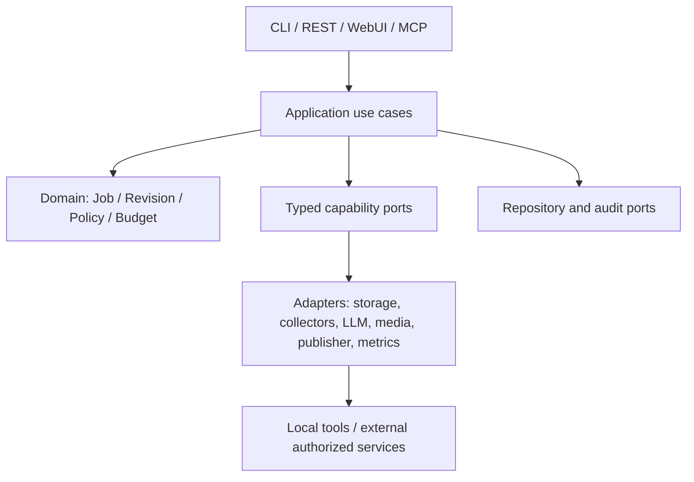

# 02 — Architecture, persistence and execution

## 1. Dependency structure

Python modular monolith, CLI-first. Core uses pure domain types and state transitions; no SDK, web request, subprocess, UI, GPU, DB imports. Application coordinates, depends only on ports and Core. Infrastructure implements ports; composition root selects providers by immutable config and capability check. A local REST layer later calls exactly the same use cases. External Node renderer consumes a validated storyboard/scene bundle, not DB credentials. No microservices or event broker needed initially. Single host process plus isolated subprocess workers. Cross-process resource locks use SQLite leases or host-level lock; no separate SQLite writers across network filesystem.

## 2. Component responsibilities

| Module | Owns | Cannot own |
|---|---|---|
| core | identifiers, money, rules, graph, lifecycle, invariants | network, vendor prompts |
| application | commands, orchestration, approvals, retry decision | vendor-specific payloads |
| research | candidates, normalized sources, claims, ranking | publishing |
| studio | briefs, script variants, storyboard, translation | mutable source facts |
| media | asset plan, generation, rendering, QC | spend authorization |
| compliance | rule evaluation and evidence, review demands | automatic override of prohibitions |
| distribution | destination packages, consent, external receipts | provider eligibility claims without evidence |
| business | offers, events, attribution, ledger, experiments | spending or payment without approvals |
| infrastructure | repository, adapters, secrets, OS, telemetry | bypass domain checks |

Suggested package tree: `src/contentflow/{domain,application,ports,adapters,interfaces,workflows}`, `renderer/` (Node optional), `tests/{unit,contract,integration,e2e,security,performance}`, `docs/`, `schemas/`, `fixtures/`. Core public import graph tested. No circular coupling with Engram/PeerHub.

## 3. Identity and storage

Use UUIDv7 or UUID4 with stable generated IDs; choose one implementation before migrations. Domain IDs never inferred from filenames. Immutable revision numbers monotonically increase per entity. All times UTC RFC3339; reports use declared timezone. SHA-256 over exact bytes for assets, canonical JSON RFC 8785 or pinned deterministic equivalent for structured artifacts. Define one canonicalization in ADR before hash tests. Decimal money as integer minor units + ISO 4217 currency and scale, no floating point. Rates as decimal strings and date/source; KRW scale 0, USD scale 2. IDs and workspace ownership checked on every operation.

SQLite WAL with busy timeout, foreign keys, migration history, local disk only. Keep transaction short; no network in transactions. Content-addressed object storage `objects/sha256/aa/<digest>`, temp file in same filesystem, fsync then atomic rename, record verified hash/size in DB. On crash between object and row, orphan reconciler checks quarantine/retention. No cross-workspace dedup of confidential material in hosted mode. Backups use SQLite backup API plus a manifest of immutable referenced objects, verify restore in new path before replacing production. No copying active WAL DB blindly.

### Logical tables (not SQL implementation)

`workspace(id, config_rev)`; `project(id, workspace_id, charter_rev, locale, risk)`; `source(id, project_id, canonical_url, fetched_at, policy_id, retention_until, blob_ref?, hash?)`; `claim(id, brief_rev, statement, evidence_refs, status, review_actor)`; `brief(id, project_id, rev, claims, analysis, status)`; `content(id, project_id, rev, brief_rev, locale, format, lineage)`; `asset(id, project_id, sha256, mime, license_id, lineage, status)`; `artifact(id, content_rev, type, sha256, dependency_hash)`; `job(id, workflow_rev, status, idempotency_key, lease_token, lease_until, version)`; `step(id, job_id, key, dependency_hash, status, attempt, lease_token)`; `approval(id, subject_rev, action, digest, rule_rev, actor, expires_at, consumed_at?)`; `publication(id, destination_account, content_rev, status, remote_id?, request_key, intent_hash)`; `reservation(id, job_id, provider, currency, amount, status)`; `ledger_event(id, external_event_key, amount, currency, type, correction_of?)`; `metric_observation(id, platform, remote_id, metric, period, semantics_rev, value?, state)`; `audit_event(id, action, actor, correlation_id, payload_digest, timestamp)`. Foreign keys/composite workspace uniqueness, unique idempotency keys per operation scope, schema version migrations. Derived tables rebuildable, audit metadata avoids raw personal data/credentials. Source blobs are subject to provider retention, even if a job manifest references them.

### Data retention and erasure

Raw material may be temporary, encrypted, restricted or forbidden. Registry marks retention deadline, permitted transformations, sharing scope and refresh/delete obligation. Deletion traverses cache, derivatives and backups where necessary; retain only legally allowed tombstones and minimal audit metadata. Do not keep a perpetual hash if terms or privacy obligations prohibit it. User can export owned artifacts, request purge and disconnect provider. Separate revenue records from third-party API metadata; accounting retention is configurable and jurisdiction-reviewed. Backups follow expiry and deletion policy; on restore reapply deletion journal before availability.

## 4. Workflow model

Versioned DAG, declarative allowed step kinds, validated acyclic graph and capability inputs; arbitrary shell, dynamically supplied code and untrusted plugin execution disallowed. Each step consumes named revisioned artifacts and outputs declared types. Step cache key includes normalized inputs, config/template/model/version, policy revision, provider capability snapshot and workspace; do not cache side effects or volatile/restricted responses. Reuse only verified, permission-valid outputs. DAG scheduler starts ready steps, bounded workers, explicit dependencies and GPU capacity. A changed upstream dependency invalidates descendants; preserve historical outputs but forbid stale approvals. A policy change invalidates impacted release gates even if render bytes unchanged.

Job state machine: `QUEUED -> RUNNING -> WAITING_REVIEW | WAITING_BUDGET | WAITING_EXTERNAL | SUCCEEDED | FAILED | CANCELED`; waiting states return to QUEUED upon valid resolution; RUNNING may requeue on retryable failure; terminal jobs immutable, resume creates new attempt/job linked to prior job. Distinct step states `PENDING, READY, RUNNING, SUCCEEDED, RETRYABLE_FAILED, FAILED, BLOCKED, SKIPPED, CANCELED`. SKIPPED allowed only for explicitly optional step, downstream must accept missing output. User cancellation stops new work, signals child process, waits or terminates bounded; remote operations may be unknown and are reconciled, not undone automatically.

Publication has separate states (see 06). A successful export is not a successful remote publication. Budget exhaustion and missing human approvals are expected waits, not failures. Each worker obtains lease with fencing token/version compare-and-swap; heartbeat, reclaim only after expiration; old worker cannot commit. Remote side effect may still succeed after lease loss; record intent and reconcile before retry. Exactly-once local logical commits; at-least-once delivery possible externally. On reboot recover leases and pending reconciliation, never blindly repeat post/payment calls.

Error taxonomy: `INVALID_INPUT, UNSUPPORTED_CAPABILITY, POLICY_DENIED, NEEDS_REVIEW, BUDGET_EXCEEDED, AUTH_REQUIRED, QUOTA_EXHAUSTED, RATE_LIMITED, NETWORK_TRANSIENT, PROVIDER_PERMANENT, GPU_OOM, DISK_FULL, CANCELED, REMOTE_UNKNOWN, CORRUPT_ARTIFACT, INTERNAL`. Errors structured with safe reason, retryability, suggested action, correlation ID; redact secrets. Retry only allowlisted idempotent operations, bounded exponential backoff with jitter and Retry-After; unknown side effects never auto retry. Circuit breaker per provider/account, not global. Timeouts for connection/read/total and process termination.

## 5. Consistency, observability and isolation

Optimistic revision checks and single-writer domain transitions; DB transaction records event and outbox intent. Outbox consumer rechecks approval, budget, destination, content digest and policy immediately before network. Audit append-only at application layer, export hash manifest; do not claim tamper-proof if local admin can rewrite disk. Distinguish execution ID, job, trace and remote request. Limit process CPU/RAM/disk/time, path allowlists, argument arrays (no shell interpolation), safe fonts and media. Plugins installed from explicit allowlist, version pinned; never execute code supplied in source text. Network egress deny by default in offline workers. Sensitive projects have provider restrictions; no data exfiltration via fallback.

## 6. Deployment and future migration

P0 Windows/Linux CPU, pinned compatible Python baseline selected after dependency spike (3.11/3.12 candidates), uv/lockfiles and isolated optional model environments; no assumption Python 3.15 works. Optional WSL2/containers for incompatible media services; test native Windows paths, Korean filenames, long paths, spaces, CRLF and timezone. Mac CPU optional later. Local REST binds 127.0.0.1, token and CSRF controls; no public exposure. Future hosted migration: Postgres + object store, tenant-scoped authorization, queue, worker sandbox, per-tenant budget, isolated credentials, deletion, abuse handling and billing; independent ADR and penetration testing before P3.

## 7. Portable deployment boundary

See 14 for runtime roots, offline reconstruction, host prerequisites, pack integrity and optional remote worker. Core uses logical artifact keys; absolute paths are confined to runtime composition. Cross-host job transfer uses authenticated artifact exchange, never network WAL or copied live DB.
