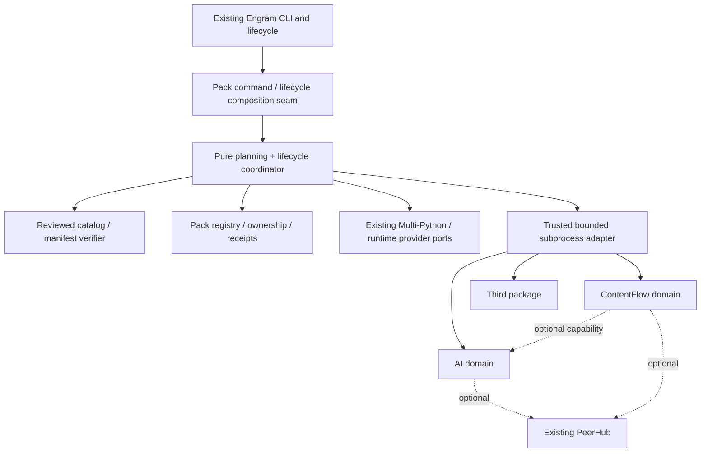

# Architecture, authority and physical layout

## 1. Minimal dependency direction



Core does not import AI, ContentFlow, FFmpeg, model runtimes or domain libraries. Pack planning and metadata use standard-library-first code within supported Engram interpreter. No DB/server/GUI dependency for common manager, no per-pack daemon in P0. Physical module placement is a proposed increment, not instruction to reorganize existing core: `core/pack/{catalog,registry,plan,transaction,adapter,cli}.py` (names subject to codebase conventions). Use existing root, path guards, env_manifest, env_lock/env_ops, secure download/archive extraction, CLI result pipeline. Reuse existing providers through narrow ports; do not generalize unrelated tool installers prematurely. Resource lease may be a separate P1 primitive. Explicit composition seam maps existing command to installed package operation; no package-specific branching in lifecycle core after initial catalog/wrapper registration.

## 2. Layer ownership and prohibition matrix

| Authority | Owns | Never owns |
|---|---|---|
| Core lifecycle | Engram install identity, legacy runtime, update/uninstall host cleanup | AI memory, video/marketing, provider billing |
| Pack manager | descriptor, release admission, pack registry, installation generations, app launch, plan/approval/journal, ownership, coordinated lifecycle | content DB schema, LLM memory, vendor-specific data migration logic, actual publication |
| Runtime manager | exact interpreter/build, environment bindings, native dependency pins, ref graph | package domain data and business approval |
| AI adapter | AI profile, provider apps, model store, native service checkpoint, database restore | another package's data or installation |
| CF adapter | CF package profile, app state migration/quiesce/checkpoint/restore | re-installing host Python/Node in managed mode, global lifecycle |
| Package domain | workflow, model/service choices, scoped business consent, content and results | trust root, global registry ownership, other package credentials |
| Release pipeline | immutable tested artifacts, manifests, version + provenance, license/SBOM | mutable user data, runtime cache, source credentials |
| User/OS | trust admission, account sign-in, permissions, driver, external projects | automatic authority inherited from install, copy or restore |

No physical root path or package record supplied by a domain can grant wider ownership. Runtime provider identity and package artifact identity are separate. A Python pip distribution is not a managed application package; preserve `engram update --only packages`. ContentFlow's own Lite/Studio/Voice/GPU components are *features* within one registered application, not separate Engram app IDs by default. AI profiles retain existing semantics; no nested installation of Engram inside ContentFlow.

## 3. Physical paths and data lifetimes

Use `system_dir = core.root.find_root(...)`; `install_root = system_dir.parent`. In documents `_sys` is the default human-visible name only. All persisted managed relative paths use one anchor `SYSTEM` (no `_sys/` prefix), slash separators, ASCII identifiers, normalized Windows identities. External user roots are separate opaque references with explicit consent, never filesystem ownership targets. Root-relative paths in older ContentFlow/v0.2 are mapped only through explicit adapter conversion; never run global string replacement on source files or memory.

```text
Engram/
  Engram.exe / engram.cmd / workspace/ / .engram/  existing
  _sys/                                           actual name may differ
    core/pack/                                    reviewed generic code (proposed)
    cli/engram.cmd, ai.cmd, contentflow.cmd         known thin wrappers
    defaults/packages/                            reviewed static catalog, schemas, trust policy
    data/state/                                    existing env.manifest + env-op journal
      package-registry.json                       one authoritative installed pointer per pack
      pack-operations/<op-id>/                    bounded receipts, no credentials
      python-registry.json                        existing draft WP1 authority, separate
    data/setup-files/                             verified cache, not shipped
    env/python/ & env/venv/                       legacy unchanged
    env/python-versions/<series>/<build-id>/       runtime authority
    env/python-envs/<owner>/<env-id>/              separate immutable app environments
    AI/                                            Rev06 compatibility slot
      core/, defaults/, apps/, runtime/, models/, config/, data/, secrets/, state/ ...
    ContentFlow/                                   same level, independent
      app/generations/<gen>/                      verified immutable release, lifecycle adapter
      defaults/                                   versioned safe static defaults
      config/                                     user's policy, no auto enrollment
      workspaces/                                 CF-owned project/DB/artifacts
      packs/ models/                              internal feature/model state
      state/                                      durable recovery manifest copy, not registry authority
      logs/ cache/ backups/                       classified, private
    packages/<id>/                                future slot
```

AI's existing Rev06 `core/defaults/apps` layout remains; verified adapter generation may be stored in its owned immutable subfolder only if compatible, not forcibly reparented. App generation and its Python env are at final immutable names before use; never rename a constructed venv. Use a reviewed mapping `id -> slot_rel` in trusted catalog: `ai -> AI`, `contentflow -> ContentFlow`, other `id -> packages/id`. `packages` here is directory name, unrelated to pip selector. Each slot has a protected recovery inventory written with its parent receipt (not a second active pointer). Registry missing/corrupt -> do not treat it as authoritative for adoption, use inventory only to propose explicit repair. `DATA_RETAINED` tombstone stores no active generation and still guards slot from implicit deletion/overwrite.

Asset classes: `PROGRAM` immutable, `RUNTIME_REF` manager binding (not own bytes), `DOMAIN_DATA` durable, `USER_CONFIG` durable, `SECRET_REF` protected/nonexported default, `MODEL_DATA` user-retained by default, `CACHE` disposable only unreferenced, `LOG` bounded/retained per policy, `BACKUP` protected, `EXTERNAL_REF` never deletion target. Ownership catalog identifies scope, origin, generation, immutable member hash or durable checkpoint protocol; directory name by itself never proves file ownership. Immutable program members are exact release file list; newly discovered files in program tree are foreign and block broad deletion. Directory removal only if empty and owned. Existing known vendor private runtime and mutable domain trees require explicit typed admission. No wildcard path from untrusted input.

## 4. Catalog, registry and provider boundaries

- Reviewed catalog = available identities, profiles and supported protocol ranges. Registry = installed/retained binding, revision and exact manifest digest; cache = downloaded artifacts; service state = observation. No duplicate active pointer in package-owned config.
- App version, catalog version, schema/protocol version, runtime build id, environment id, model revision, workspace schema and installation id are distinct. Compare numeric SemVer for application version, PEP 440 only for Python packaging metadata. Support stable exact versions initially, no mutable tag as identity. Unknown major -> BLOCKED, not automatic migration.
- A first-party trusted catalog is static in core release; user can install a reviewed signed offline artifact with known catalog ID. Third synthetic pack extends descriptor and fixture release metadata only; generated alias registration and ordinary trust entry are expected, not product-specific Core logic. Arbitrary repo URL/executable catalog is not P0. Cross-pack hard dependency P0 rejects, not installs automatically. Capability graph: selected profile -> required runtime/provider/features; optional references separately report unavailable. Future hard deps need reviewed DAG/version solver extension, no dynamic install-on-run.
- Shared runtime port: `inventory(read_only)`, `resolve(requirement, observed)`, `prepare_binding(candidate, consumer, lock_ref)`, `stage_and_probe`, `prepare_publication`, `recover_step`, `refs` (logical contract, not existing methods). Manager never edits runtime registry raw bytes. #145 actual `publish(system_dir, expected_revision, document)` acquires lock; extend WP3 with one under-coordinator prepare/step port, not nested call. Unknown refs block deletion. Exact compatibility includes provider, implementation, version, ABI, architecture, flavor, artifact digest, consumer lock and successful native probe; share binary only, not site-packages or npm prefix. Extra Python owner key `pack-<id>-<component>` stable and collision-checked, unique env generation; no AI-special path required for new bindings.
- Runtime providers independently maintained: legacy Python/venv unchanged, extra CPython per WP0/WP1; Node and generic tools reuse existing registry only where exact identity compatible; FFmpeg/Browser new provider only after first verified consumer. Vendor runtime exception private, explicit and licensed, not auto promoted to shared. No implicit latest/global pip, host PATH fallback, global HOME mutation, admin install, model download or remote calls.

## 5. Detection and lifecycle scope

Catalog AVAILABLE/UNAVAILABLE is independent from registry presence and integrity. Installed state: ABSENT, INSTALLED, PARTIAL, DATA_RETAINED, UNKNOWN, CORRUPT, LEGACY_COLLISION. Health: NOT_CHECKED, HEALTHY, DEGRADED, BLOCKED; process STOPPED/STARTING/RUNNING/DRAINING/UNKNOWN separate. ABSENT = no valid registry entry AND no owned/foreign slot collision; static catalog alone not install. Missing registry with surviving slot -> UNKNOWN, not absent. Foreign marker, duplicate or corrupt registry -> fail closed for mutation; never delete or auto-adopt. Doctor shallow checks static metadata/hash/path and cached service evidence, not run adapter code or start apps; deep probes only explicit, bounded and no side effects outside approved scratch. Normal existing Engram with no pack never creates pack directories/state, starts processes, checks remote pack metadata, changes legacy output or downloads assets.

## 6. Resource sharing

P0 CPU slice only. No global GPU service. P1 cooperative per-installation resource gate with machine/device identity (PCI/UUID where supported), process creation time, lease owner generation and monotonic fencing. If multiple roots or users require exclusive GPU, use reviewed host/session-wide shared namespace with ACLs, validation and cleanup first; otherwise report scope limitation and refuse unsafe concurrency. See security doc. No shared writable native vendor model directories. Share immutable blob only if digest/license/access/trust/model format match and vendor contract supports read-only access. No hardlink/junction dependency on an external unowned root. Cost allocation for CF paid providers remains CF domain; manager cannot authorize consumption by installing adapter.
